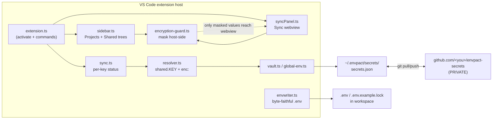

# envpact (VS Code)

> Manage your centralized, serverless secrets vault visually — inside the editor.

[](./LICENSE)
[](https://github.com/chirag127/envpact-vscode-vsc-ext/stargazers)
[](https://github.com/chirag127/envpact-vscode-vsc-ext/commits)
[](https://marketplace.visualstudio.com/items?itemName=chirag127.envpact)
[](https://marketplace.visualstudio.com/items?itemName=chirag127.envpact)

**Live site:** https://envpact-vscode-vsc-ext.oriz.in · **GHP landing:** https://chirag127.github.io/envpact-vscode-vsc-ext/ · **Repo:** https://github.com/chirag127/envpact-vscode-vsc-ext

⭐ If this is useful, please star the repo — it helps others find it.

Browse projects, sync per-key from a tree view or a dedicated Sync panel, rotate shared secrets, and generate `.env` files without leaving VS Code. Part of the [envpact](https://github.com/chirag127/envpact) ecosystem — the same Git-backed vault the CLI, MCP server, GitHub Action, Python package, and dashboard all read.

## Architecture



## Features

- **Projects sidebar** with per-key status icons for the active workspace project: ✓ synced, ↑ local_newer, ↓ vault_newer, ⚠ both_diverged, 🆕 local-only / vault-only.
- **Shared secrets sidebar** with masked encrypted / plain indicators.
- **Per-key sync, two surfaces** — right-click any key for Pull / Push / Force pull / Force push (each shows a masked confirmation before any disk write), or open the **Sync panel** for a single-page table with status badges, dual-rendered timestamps, masked previews, per-row buttons, and bulk "Pull/Push all available".
- **Timestamp dual-render** — every conflict prompt shows both UTC and IST (`Asia/Kolkata`, fixed regardless of machine timezone); the newer side is annotated `(Recommended — newer)`.
- **Global vault `.env`** at `~/.envpact/.env` mirrors every shared secret; regenerate via `envpact: Sync Global .env`.
- **Byte-faithful `.env` generation** — the rendered file mirrors `.env.example` line-by-line: comments, blank lines, key order, CRLF, and trailing newline preserved verbatim. Missing keys become `# KEY: unresolved`.
- **`.env.example.lock`** sidecar tracks last-synced state per key for spec-compliant conflict detection.
- **Status bar** showing active project + vault status; click to open the Sync panel.

## Tech stack

TypeScript · VS Code Extension API (`^1.85.0`) · webview with strict CSP (`default-src 'none'; script-src 'nonce-…'`) · `@vscode/vsce` for packaging · `tsx` for tests · pnpm.

## Repo structure

```
src/
  extension.ts         # activate(), command registration
  sidebar.ts           # Projects + Shared TreeDataProviders
  syncPanel.ts         # Sync panel webview controller
  syncPanelHtml.ts     # static webview template (never holds a secret)
  sync.ts              # per-key sync status computation
  resolver.ts          # shared.KEY + enc: resolution
  envwriter.ts         # byte-faithful .env rendering
  vault.ts             # vault read/write
  global-env.ts        # ~/.envpact/.env mirror
  encryption-guard.ts  # host-side value masking
  timestamps.ts        # UTC + IST dual-render
  watcher.ts / setup.ts
resources/             # icons
scripts/test.mjs       # test runner
tests/                 # incl. no-secret-bleed canary
```

## Install

Search "envpact" in the Extensions sidebar, or:

```
ext install chirag127.envpact
```

Then create a vault if you don't have one: Command Palette → `envpact: Initialize Vault` → **Auto** (creates a private repo via the `gh` CLI). Or from a terminal: `npx envpact-cli --init auto`.

## Build from source

```bash
pnpm install
pnpm run compile   # tsc -p ./
pnpm test          # node scripts/test.mjs
pnpm run package   # vsce package → .vsix
```

## Configuration

Extension settings (Settings UI or `settings.json`). No secret values are ever stored here — only behaviour.

| Setting | Purpose |
| :--- | :--- |
| `envpact.autoPullOnGenerate` | Pull the vault repo before generating `.env`. |
| `envpact.exampleFile` | Workspace-relative path of the `.env.example` to use as the spec. |
| `envpact.outputFile` | Workspace-relative path of the target `.env` file to write. |
| `envpact.writeMode` | Existing-file handling: `ask` / `merge` / `overwrite` / `dry-run`. |
| `envpact.autoSyncOnSave` | Refresh sync-status indicators when a `.env` is saved. |

## Security note

No secrets in this repo. Secret values **never leave the extension host**: tree leaves show `KEY = ••••`, confirmation prompts mask via `maskValue` (first 3 + last 3 chars), and the Sync-panel webview receives only key names, status enums, ISO timestamps, and pre-masked previews under a strict CSP. Tests include a canary asserting no fixture value bleeds into rendered HTML. Vault trust root = "keep the vault repo private"; `sops`+`age` encryption is opt-in per secret; `PUBLIC_*` values are client-only.

## Compatibility with the rest of envpact

| | Reads vault | Writes vault | Per-key sync |
| :--- | :---: | :---: | :---: |
| envpact-cli (`npx envpact-cli`) | ✓ | ✓ | ✓ |
| envpact-mcp (AI agents via MCP) | ✓ | ✓ | ✓ |
| envpact (Python) | ✓ | ✓ | ✓ |
| envpact-vscode (this) | ✓ | ✓ | ✓ |
| envpact-action (CI/CD) | ✓ (read-only) | — | — |

## Part of the oriz family

One of ~80 sites and tools in the [oriz](https://blog.oriz.in) family by Chirag Singhal — hosted **$0 on the Cloudflare free tier** (the landing site; the extension itself is client-side). Siblings: the [envpact](https://github.com/chirag127/envpact) monorepo · [ghosttyper-bs-ext](https://github.com/chirag127/ghosttyper-bs-ext) (another 100%-client-side extension).

## Contributing

PRs welcome; open an issue first for large changes. Conventional commits are the changelog. See [CHANGELOG.md](./CHANGELOG.md).

## Status

Stable — published on the VS Code Marketplace and Open VSX (v0.6.0, v3.1 UX on the v3 flat vault schema).

## License

MIT © Chirag Singhal — chirag@oriz.in · see [LICENSE](./LICENSE).
